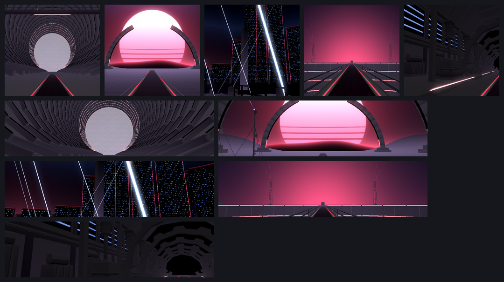

# BoredSaber

A Beat Saber-style VR rhythm game made in Godot 4.6.2 with OpenXR. It is built and tuned for the standalone
**Pico 4** at 72 Hz on the Compatibility (OpenGL ES) renderer; other OpenXR headsets should work too. Songs are
[BeatSaver](https://beatsaver.com/) maps: download them in the game and they stay playable offline.

## Features

- **Stages:** Classic, Neon Grid, Night City, Pulse Void and Metal Factory, each with its own light show, or
  "Follow map" to let the song pick (`game/env/`).
- **Curved song menu:** the song and its ranks on the left, the song list in the centre, modifiers on the right,
  curved around the player (`game/ui/BeepSaberMainMenu.tscn`).
- **Modifiers:** walls, bombs, arrows, map colours, speed, fail modes and damage, plus block size, width, mirror,
  saber colours and short sabers.
- **Players:** several profiles on one headset, each with its own height and handedness ("Who's playing?").
- **Highscores with grades** (SS to D) per song, difficulty and modifiers.
- **Download page:** search and filter BeatSaver; each map's difficulty levels are estimated before download
  (`doc/research/download-level-estimate.md`).
- **Even loudness:** every song is measured (ITU-R BS.1770) and played at the same loudness.
- **Spatial mistake sounds:** bad cuts, wrong sabers, bombs and misses are heard from where the note was.

## Install on Pico 4

1. In the headset's browser, download the latest build:
   https://github.com/BoredOrMore/BoredSaber/releases/download/pico4-latest/BoredSaber-Pico4.apk
2. Open it in the File Manager and install it.
3. Find it in the Library under the "Unknown sources" filter.

For development, `adb install -r BoredSaber-Pico4.apk` works too. To keep the headset awake while it's off your
head, run `adb shell setprop pvr.factorytest.never.sleep 1` (it resets on reboot).

## Build and develop

- **CI:** `.github/workflows/build-pico4.yml` builds the APK on every push with Godot 4.6.2 and
  godot_openxr_vendors 4.3.1, uploads it as the `BoredSaber-Pico4` artifact, and updates the `pico4-latest`
  release from `pico4-offline` and the default branch.
- **Renderer and OpenXR:** Compatibility renderer and OpenXR 1.0. On Pico OS 5.12 the Vulkan path crashes
  inside the Pico runtime, and the runtime rejects OpenXR 1.1 binding paths.
- **Tests** run headless, for example `godot --headless --path . res://tests/test_menu_layout.tscn`; CI runs
  every scene in `tests/`.
- **Capture tools** (`tools/capture/`): `ui_angles` measures every panel, button and line of text in degrees
  from the player's eye; `env_thumbnails.sh` renders the stages' picker pictures; `stage_capture` renders a
  stage as the player sees it.
- **Docs:** each folder has an `AGENTS.md` (file map, gotchas, where to change what). CI fails when a script,
  scene or shader isn't named in its folder's `AGENTS.md` (`tools/check_agent_docs.py`). Design and review
  guides live in `.claude/skills/`: `vr-ui-design`, `vr-ui-review`, `rhythm-world-design`, `shader-design` and
  `game-model-creator`.

## Branches

`godot-4-port` is the main branch. Work goes on `pico4-offline` and reaches `godot-4-port` through pull requests.

## Credits

- Based on [Beep Saber](https://github.com/NeoSpark314/BeepSaber) by Holger Dammertz (NeoSpark314) and Open Saber
  Plus by Alexander Pruss, with the
  [Godot Oculus Quest Toolkit](https://github.com/NeoSpark314/godot_oculus_quest_toolkit) (`OQ_Toolkit/`, partly
  ported to Godot 4 and OpenXR).
- Included song: Time Lapse by TheFatRat.
- Fonts: Roboto (Apache 2.0 in `LICENSE`; OFL for the variable font, `game/ui/fonts/OFL.txt`) and Kanit Black
  Italic (OFL, `game/ui/fonts/Kanit-OFL.txt`).
- Icons: [Lucide](https://lucide.dev/) (ISC, `game/ui/icons/LICENSE`).
- Night sky image: ESO/S. Brunier, CC BY 4.0.

## Licence

The game's code is MIT licensed. See `LICENSE`, which also carries the Roboto and night sky licences.
